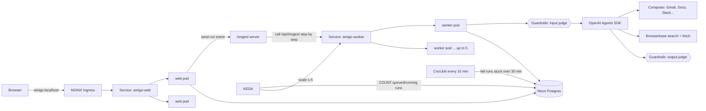

# AMIGO AI

**Describe a job in one sentence. AMIGO builds an AI agent for it, connects it to your real apps, and runs it on a schedule, with safety checks on every run and a log of everything it did.**

*"Every morning at 7, read my new emails and save a short digest to Google Docs."* That one prompt becomes a configured, scheduled agent: the right tools (Gmail, Google Docs, Slack, Notion, web research and more), a written system prompt, and autonomous execution on the OpenAI Agents SDK. It runs as separate **web** and **worker** services in **Docker** and on **Kubernetes**, with **queue-depth autoscaling**, **LLM-as-judge guardrails** and **structured JSON logs**.

---

## Highlights

- 🧠 **Prompt-to-agent generation.** Google Gemini reads the request, picks the tools it needs, asks follow-up questions when something is vague, and returns a full agent config (instructions, goal, schedule, output format) as structured JSON.
- 🔌 **Real app integrations.** [Composio](https://composio.dev/) handles OAuth per user. Each agent gets a session scoped to only the apps its job needs (Gmail, Slack, Notion, Google Docs/Sheets/Calendar, GitHub, LinkedIn, Outlook and more).
- 🌐 **Live web research.** Two read-only [Browserbase](https://www.browserbase.com/) tools, `web_search` and `fetch_page`, let agents find current news, prices and facts, read the pages, and cite their sources.
- 🛡️ **LLM-as-judge guardrails.** A `gpt-4o-mini` judge screens every task **before** any tool runs (toxicity, prompt injection, sensitive PII, harmful actions) and reviews every answer **after** (leaked secrets, indirect prompt injection, unsupported claims, an on-task score). Plus regex secret detection with automatic redaction.
- ⏰ **Background jobs and scheduling.** [Inngest](https://www.inngest.com/) queues runs, retries failed steps, sleeps until the exact scheduled time, and chains the next daily run. An atomic status update stops the same run from being executed twice.
- 📦 **Containerized.** A multi-stage, non-root Docker image runs as two services, **web** (UI + API) and **worker** (agent execution), plus a self-hosted Inngest server.
- ☸️ **Kubernetes.** Multi-replica Deployments with rolling updates, resource limits and liveness/readiness probes, plus Services, an NGINX Ingress, a ConfigMap and Secrets. **KEDA scales workers on queue depth** read from Postgres, and a **CronJob** cleans up runs left stuck by dead workers.
- 📊 **Observability.** Every log line is JSON with `service`, `pod`, `runId` and `agentId`, so one run's whole journey can be followed across replicas with `kubectl logs`.

---

## Architecture



### What happens on a run
1. **Web** saves a `queued` row in `agentRun` and sends an `agent/run.execute` event to Inngest.
2. **Inngest** calls the **worker** Service. Each step (`load`, `mark started`, `execute`, `mark completed`) is a separate, retryable HTTP call.
3. The worker atomically flips `queued → running` (`UPDATE … WHERE status = 'queued' RETURNING`), so a duplicate event can never run the same job twice.
4. The **input guardrail** judges the task. It's blocking (`runInParallel: false`), so no tool runs before the verdict.
5. The agent runs with its Composio tools and Browserbase. Every tool result is recorded.
6. The **output guardrail** reviews the answer against those tool results. The verdict and output are saved, and the run becomes `completed`, `blocked` or `failed`.
7. **KEDA** sees the queue grow and adds worker pods. When the queue drains, it removes them after a 60 s stabilization window.

---

## Safety guardrails (LLM-as-judge)

Implemented in [`lib/guardrails.ts`](lib/guardrails.ts) using the OpenAI Agents SDK's built-in input and output guardrails and tripwires.

| Layer | When | Checks | Action |
|---|---|---|---|
| **Creation screen** | Before Gemini builds an agent | Same as the input judge | Unsafe agents are never created |
| **Input judge** | Before any tool runs | Toxicity, prompt injection, sensitive PII (passwords, OTPs, card/bank numbers, government IDs), harmful actions (phishing, spam, mass deletion, sending data to outsiders) | **Block** (`blocked` status, with a reason) |
| **Output judge** | After the agent answers | Leaked secrets/PII, indirect prompt injection (following instructions found inside emails or pages), claims the tool results don't support, on-task score 1–5 | **Block** only *confirmed* leaks or harmful content; **flag** the rest |
| **Pattern layer** | On every answer | Regex for API keys, tokens, private keys, and card numbers (Luhn-checked) | **Redact** automatically |

**Evidence-based blocking.** LLM judges over-block. An email saying "your API key expires soon" was once flagged as a leak. So the output judge has to quote the exact secret it found, and code checks that the quote really appears in the answer and looks like a secret before blocking. Unproven claims are flagged for review instead. Every verdict is stored on the run and shown as a **Safety review** panel in the run log.

Ordinary contact names and email addresses are deliberately **not** treated as sensitive. Summarising your own inbox needs them.

---

## Structured logging

[`lib/logger.ts`](lib/logger.ts) uses [pino](https://getpino.io/). Every line is one JSON object:

```json
{"level":30,"time":"2026-10-25T06:35:42.247Z","service":"amigo-worker","pod":"amigo-worker-5686bdbfcb-4x7kf","runId":"c237be21-…","agentId":"6df43227-…","durationMs":60928,"msg":"agent finished"}
```

- `service` tells web and worker apart; `pod` comes from Kubernetes (Downward API), so replicas can be told apart.
- A run's lifecycle is logged: `run queued manually` → `run started` → `guardrail input verdict` → `guardrail output verdict` → `agent finished` / `run blocked by guardrail` / `run failed`.
- Secrets are redacted (`apiKey`, `token`, `password`, `authorization`).
- Logs inside Inngest functions are written inside `step.run`, because Inngest replays function code between steps and a log outside a step would print more than once.

Health endpoints for probes: `GET /api/health` (liveness, no dependencies) and `GET /api/ready` (readiness, pings the database).

---

## Tech stack

| Layer | Technology |
|---|---|
| App | [Next.js 16](https://nextjs.org/) (App Router, standalone output) + React 19 + TypeScript |
| Auth | [Clerk](https://clerk.com/) |
| Database | [Neon](https://neon.tech/) serverless Postgres + [Drizzle ORM](https://orm.drizzle.team/) |
| Agent planning | [Google Gemini](https://ai.google.dev/) (`@google/genai`), structured output |
| Agent runtime | [OpenAI Agents SDK](https://github.com/openai/openai-agents-js), guardrails |
| App integrations | [Composio](https://composio.dev/) |
| Web research | [Browserbase](https://www.browserbase.com/) |
| Background jobs | [Inngest](https://www.inngest.com/) (self-hosted in Docker/Kubernetes) |
| Logging | [pino](https://getpino.io/) |
| Containers | Docker (multi-stage, non-root), Docker Compose |
| Orchestration | Kubernetes (minikube), NGINX Ingress, [KEDA](https://keda.sh/), metrics-server |
| UI | Tailwind CSS 4, shadcn/ui on Base UI |

---

## Project structure

```
app/
  api/            → route handlers: agents, runs, tools, integrations, health/ready, inngest
  dashboard/      → overview, agents, run log, connections, preferences, account
components/custom → agent creation/chat/edit UI, run log, sidebar
db/               → Drizzle schema (users, tools, agentConfig, agentRun) + client
inngest/          → scheduler (cron) and executor functions
lib/              → agent builder/runner, guardrails, logger, Composio, Browserbase tool
scripts/          → cleanup-stuck-runs.mjs (run by the Kubernetes CronJob)
k8s/              → Kubernetes manifests (applied in file order)
Dockerfile        → multi-stage image for web, worker and maintenance jobs
docker-compose.yml→ web + worker + self-hosted Inngest
```

---

## Running it

You need **Node.js 20+**, a **Neon** (or any Postgres) database, and keys for **Clerk, OpenAI, Google AI Studio (Gemini), Composio and Browserbase**. Copy the example env file and fill it in:

```bash
cp .env.example .env
```

| Variable | Purpose |
|---|---|
| `DATABASE_URL` | Postgres connection string |
| `NEXT_PUBLIC_CLERK_PUBLISHABLE_KEY`, `CLERK_SECRET_KEY` | Clerk auth |
| `NEXT_PUBLIC_CLERK_SIGN_IN_URL`, `NEXT_PUBLIC_CLERK_SIGN_UP_URL` | `/sign-in`, `/sign-up` |
| `GOOGLE_CLOUD_GEMINI_API_KEY` | Gemini, plans agent configs |
| `OPENAI_API_KEY`, `OPENAI_MODEL` | Runs agents (e.g. `gpt-4o-mini`) |
| `JUDGE_MODEL` | Guardrail judge model (default `gpt-4o-mini`) |
| `COMPOSIO_API_KEY` | App integrations |
| `BROWSERBASE_API_KEY` | Web research tools (Search + Fetch) |
| `INNGEST_DEV` | `1` for local dev (overridden in Docker/Kubernetes) |
| `LOG_LEVEL` | `info` by default |

Push the schema to your database:

```bash
npm install
npm run db:push
```

### Option 1: local development

```bash
npm run dev                    # http://localhost:3000
npx inngest-cli@latest dev     # second terminal, Inngest dev server on :8288
```

### Option 2: Docker Compose (web + worker + Inngest)

```bash
docker compose up --build      # http://localhost:3000, Inngest UI on :8288
docker compose logs -f worker  # watch agent runs as JSON logs
docker compose down
```

### Option 3: Kubernetes on minikube

```bash
# Cluster and add-ons
minikube start --driver=docker
minikube addons enable ingress
minikube addons enable metrics-server

# Build the image and load it into the cluster
docker compose build web
minikube image load amigo-ai:1.2.1

# KEDA (queue-depth autoscaling)
kubectl apply --server-side -f https://github.com/kedacore/keda/releases/download/v2.21.0/keda-2.21.0.yaml

# Namespace, secrets from .env (never committed), then everything else
kubectl apply -f k8s/00-namespace.yaml
kubectl create secret generic amigo-secrets --from-env-file=.env -n amigo
kubectl apply -f k8s/

kubectl get pods -n amigo -w   # wait for all pods to be 1/1 Running
minikube tunnel                # separate terminal, then open http://amigo.localhost
```

| Manifest | What it creates |
|---|---|
| `00-namespace.yaml` | `amigo` namespace |
| `01-configmap.yaml` | Non-secret settings (log level, in-cluster Inngest URL, Node network timeout) |
| `02-inngest.yaml` | Self-hosted Inngest Deployment + Service |
| `03-web.yaml` | Web Deployment (2 replicas, rolling updates, probes, limits) + Service |
| `04-worker.yaml` | Worker Deployment (replicas managed by KEDA) + Service |
| `05-ingress.yaml` | NGINX Ingress for `amigo.localhost` (300 s timeout for long chat runs) |
| `06-cronjob-cleanup.yaml` | CronJob every 10 min: fail runs stuck over 30 min |
| `07-keda-autoscaling.yaml` | KEDA ScaledObject: 1–5 workers, one per queued/running run |

Useful commands:

```bash
kubectl logs -n amigo -l app.kubernetes.io/component=worker -f --prefix   # follow all workers
kubectl get hpa -n amigo -w                                               # watch autoscaling
kubectl delete pod <worker-pod> -n amigo                                  # watch self-healing
kubectl create job --from=cronjob/cleanup-stuck-runs cleanup-now -n amigo # run cleanup now
minikube stop                                                             # stop everything, keep state
```

---

## Engineering notes

Problems hit while containerizing and deploying, and how they were fixed:

- **Build-time crashes inside Docker.** `next build` loads every route file with no secrets present, so clients created at import time crashed (the Neon driver's URL check, Composio's API-key check). Fixed with a well-formed placeholder DB URL and a lazily created Composio client.
- **Neon timing out only inside Docker.** DNS, internet and raw TLS all worked, but `fetch` failed in about 1 s. Node's Happy Eyeballs gives each address 250 ms, and the Docker → AWS us-east-2 connection needs longer. Fixed with `NODE_OPTIONS=--network-family-autoselection-attempt-timeout=3000`.
- **Next.js standalone and `HOSTNAME`.** The standalone server binds to `$HOSTNAME`, which Docker sets to the container ID. The image pins `HOSTNAME=0.0.0.0`, and logs read the pod name from `POD_NAME` instead.
- **Inngest pod never ready on Kubernetes.** Kubernetes injects `INNGEST_PORT=tcp://…` for a Service named `inngest`, which Inngest read as its own config. Fixed with `enableServiceLinks: false`.
- **Autoscaler vs. manifest.** The worker Deployment has no `replicas` field, so `kubectl apply` doesn't fight KEDA.
- **Scaling on queue depth, not CPU.** Agent runs mostly wait on LLM and app APIs (around 20m CPU per worker), so CPU-based scaling would never trigger. KEDA reads the actual run queue.
